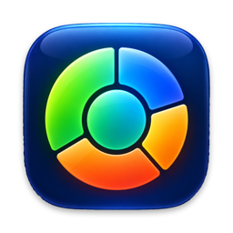
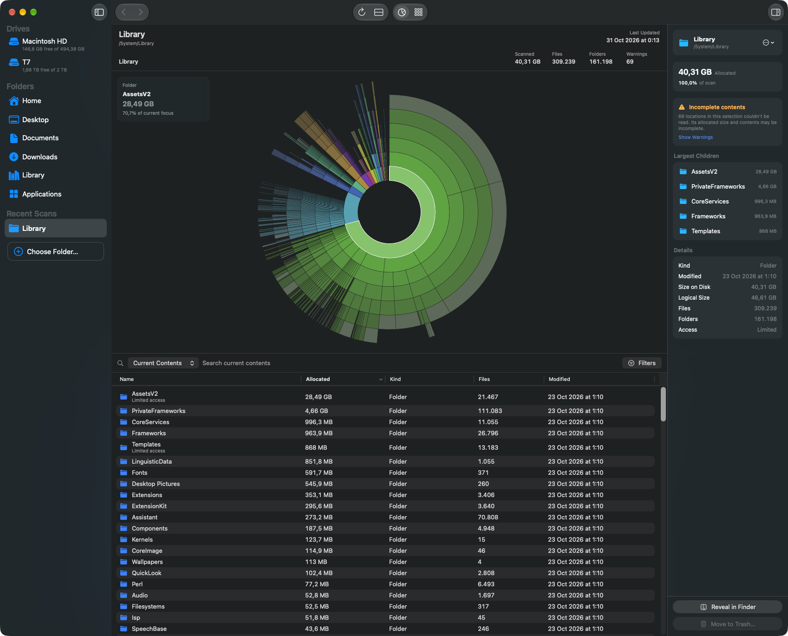

#  Attic

A native macOS disk space analyzer written in Swift and SwiftUI. Scan a folder or volume,
see where the space went in a sunburst or treemap, and move what you no longer need to the
Trash.



## Features

- Parallel scanner with live progress, built on `getattrlistbulk`. Hard links count once,
  other volumes are not entered, and unreadable folders are reported as warnings.
- Sunburst and treemap charts. Hover to inspect, click to select, double-click to drill in.
- Sortable file browser with search over the current folder or the entire scan, filters by
  kind and allocated size, Quick Look, breadcrumbs and back/forward navigation.
- Inspector with sizes, access, parent and largest children.
- Move to Trash with confirmation. System locations and the scanned location are refused,
  whatever is selected.
- Sidebar with drives, standard folders and recent scans, and drag and drop of a folder to scan it.

Folders such as Mail or Safari data need **Full Disk Access**. The app runs without the App
Sandbox because the sandbox would block scanning arbitrary locations.

Not implemented yet: scan comparison, saved scans, APFS clone detection (cloned files are
counted in full), localization, chart zoom, incremental rescans, exclusions and settings.

## Install

```bash
brew install --cask juancasanueva/tap/attic
```

The app updates itself through Sparkle: use **Attic → Check for Updates…**, or turn on
automatic checks in Settings.

## Development

Runs on macOS 15 or later. Building requires Xcode 26 or later. Open `disk.xcodeproj`, or build from the command line:

```bash
xcodebuild -project disk.xcodeproj -scheme disk -destination 'platform=macOS' build
```

Domain logic lives in `disk/Core` and has no UI dependencies. The app compiles those files
directly, and `Package.swift` exposes the same files as a package so they can be tested
without launching the app:

```bash
swift test
```

Debug builds accept `-scanPath <folder>` and `-chartMode treemap` to start in a known state.

Releases are built by a pushed version tag. See [RELEASING.md](RELEASING.md).

## License

MIT. See [LICENSE](LICENSE).